# Single-Area OSPF with Three Routers


A Cisco Packet Tracer lab where I connected three routers in a triangle and used **OSPF (Open Shortest Path First)** to share routes between three LANs. After confirming every LAN could reach every other LAN, I changed the OSPF cost on one link to force traffic down a different path.

> **Design used:** single-area OSPF. Every router is in **area 0** (the backbone), with no static routes anywhere. Each router learns the remote LANs from its neighbors.

---

## Table of Contents

1. [Topology](#topology)
2. [Addressing Plan](#addressing-plan)
3. [What Is OSPF?](#what-is-ospf)
4. [Step 1 – Planning the Network](#step-1--planning-the-network)
5. [Step 2 – Router Base Configuration](#step-2--router-base-configuration)
6. [Step 3 – Router Interfaces](#step-3--router-interfaces)
7. [Step 4 – Enabling OSPF](#step-4--enabling-ospf)
8. [Step 5 – Testing and Verification](#step-5--testing-and-verification)
9. [Step 6 – Changing the Path with OSPF Cost](#step-6--changing-the-path-with-ospf-cost)
10. [Command Summary](#command-summary)
11. [Key Takeaways](#key-takeaways)
12. [Next Steps](#next-steps)
13. [Final Configurations](#final-configurations)

---

## Topology

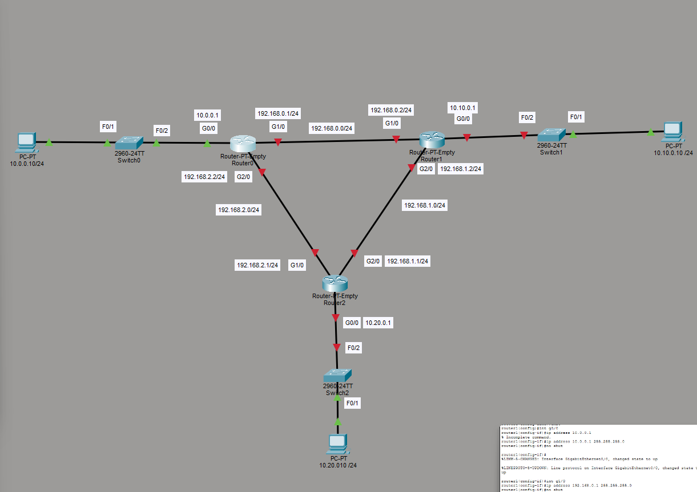

*Packet Tracer labels the routers Router0, Router1 and Router2. Their configured hostnames are **router1**, **router2** and **router3**, and this write-up uses the hostnames.*

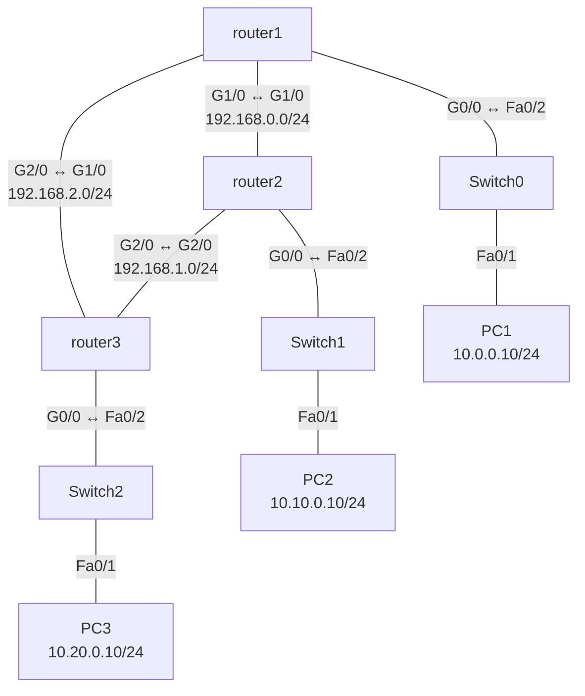

## Addressing Plan

| Device | Interface | IP Address | Subnet Mask | Default Gateway | Connects To |
|---|---|---|---|---|---|
| router1 | G0/0 | 10.0.0.1 | 255.255.255.0 | — | Switch0 Fa0/2 (LAN 1) |
| router1 | G1/0 | 192.168.0.1 | 255.255.255.0 | — | router2 G1/0 |
| router1 | G2/0 | 192.168.2.2 | 255.255.255.0 | — | router3 G1/0 |
| router2 | G0/0 | 10.10.0.1 | 255.255.255.0 | — | Switch1 Fa0/2 (LAN 2) |
| router2 | G1/0 | 192.168.0.2 | 255.255.255.0 | — | router1 G1/0 |
| router2 | G2/0 | 192.168.1.2 | 255.255.255.0 | — | router3 G2/0 |
| router3 | G0/0 | 10.20.0.1 | 255.255.255.0 | — | Switch2 Fa0/2 (LAN 3) |
| router3 | G1/0 | 192.168.2.1 | 255.255.255.0 | — | router1 G2/0 |
| router3 | G2/0 | 192.168.1.1 | 255.255.255.0 | — | router2 G2/0 |
| PC1 | NIC | 10.0.0.10 | 255.255.255.0 | 10.0.0.1 | Switch0 Fa0/1 |
| PC2 | NIC | 10.10.0.10 | 255.255.255.0 | 10.10.0.1 | Switch1 Fa0/1 |
| PC3 | NIC | 10.20.0.10 | 255.255.255.0 | 10.20.0.1 | Switch2 Fa0/1 |

The switches keep their **default configuration** (every port in VLAN 1). Each LAN is a single flat network, so the switches only need to forward frames.

---

## What Is OSPF?

OSPF is a **link-state interior gateway protocol**. Every OSPF router:

1. Finds neighbors by sending **hello packets** out of its OSPF-enabled interfaces.
2. Exchanges **link-state advertisements (LSAs)** with them until every router in the area has the same map of the network (the **link-state database**).
3. Runs **Dijkstra's Shortest Path First (SPF) algorithm** on that map to find the lowest-**cost** path to every network.
4. Installs those paths in its routing table and recalculates automatically when a link goes up or down.

Without a dynamic routing protocol, every router would need a static route to every remote network, and every change would have to be made by hand. In a three-router triangle that's already 6 static routes. OSPF does it automatically and also provides a backup path if a link fails.

---

## Step 1 – Planning the Network

I lay out my Packet Tracer labs so the diagram documents itself:

- Every link is labeled with the ports used on both ends
- Every router interface and PC is labeled with its IP address
- Every link between routers is labeled with its network address
- Switch port labels sit next to the port on the switch, not in the PC's description. I found this much easier to read.

For this lab I only configured the routers. A later lab will combine OSPF with VLANs across multiple sites (see [Next Steps](#next-steps)).

---

## Step 2 – Router Base Configuration

Each router gets the same base configuration I use in every lab: hostname, enable secret, local admin user, SSH version 2, and console, AUX and VTY line settings.

```cisco
enable
configure terminal
hostname router1
enable secret <password>
username admin secret <password>
ip domain-name marksnetwork.local
crypto key generate rsa general-keys modulus 1024
ip ssh version 2
!
line con 0
 login local
 logging synchronous
line aux 0
 login local
 logging synchronous
line vty 0 4
 login local
 logging synchronous
 transport input ssh
```

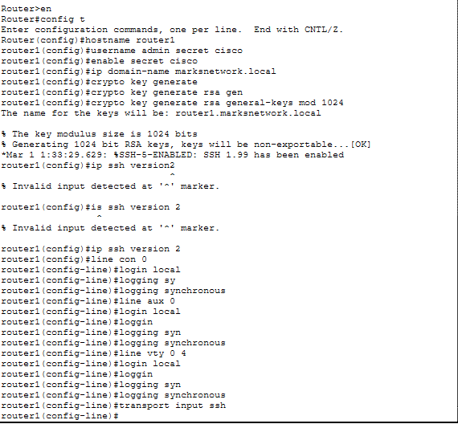

*After the RSA keys are generated, IOS reports "SSH 1.99 has been enabled", meaning it accepts both SSHv1 and SSHv2. `ip ssh version 2` then restricts it to v2 only. The typos (`ip ssh version2`, `is ssh`) get the `% Invalid input` marker. The `^` points to where IOS stopped understanding the command.*

| Command | What it does |
|---|---|
| `enable secret <password>` | Sets the privileged EXEC password and stores it as a **hash** (type 5 / MD5) |
| `username admin secret <password>` | Creates a local user. `login local` makes the lines ask for this username and password. |
| `ip domain-name marksnetwork.local` | IOS needs a **hostname and a domain name** to generate RSA keys. The key is named `router1.marksnetwork.local`. |
| `crypto key generate rsa general-keys modulus 1024` | Generates the RSA key pair that SSH needs. SSHv2 requires a modulus of at least 768 bits. |
| `ip ssh version 2` | Allows only SSHv2. SSHv1 has known weaknesses. |
| `logging synchronous` | Stops log messages from interrupting a command while you type it |
| `transport input ssh` | Allows only SSH on the VTY lines and blocks Telnet, which sends everything in clear text |

> 🔒 `cisco` is a lab-only password. Never reuse it, or any password shown in a screenshot, on real equipment.

---

## Step 3 – Router Interfaces

Each router has three interfaces in use: one for its LAN (the PCs' default gateway) and one link to each of the other two routers.

```cisco
! router1
interface GigabitEthernet0/0
 ip address 10.0.0.1 255.255.255.0
 no shutdown
!
interface GigabitEthernet1/0
 ip address 192.168.0.1 255.255.255.0
 no shutdown
!
interface GigabitEthernet2/0
 ip address 192.168.2.2 255.255.255.0
 no shutdown
```

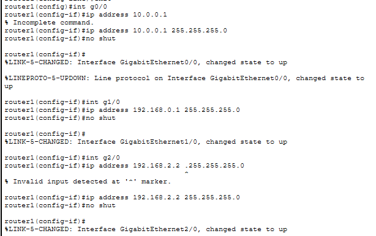

*Two mistakes caught by IOS: `ip address 10.0.0.1` without a subnet mask gives `% Incomplete command`, and a stray space before the mask gives `% Invalid input`. Each interface comes up as soon as `no shutdown` is entered.*

| Command | What it does |
|---|---|
| `interface GigabitEthernet0/0` | Enters interface configuration mode |
| `ip address <ip> <mask>` | Assigns the address. The subnet mask is required. |
| `no shutdown` | Enables the interface. **Router interfaces are administratively down by default**, unlike switch ports. |

router2 and router3 use the same commands with their addresses from the [addressing plan](#addressing-plan). Each PC was configured under **Desktop → IP Configuration** with its IP address, subnet mask and default gateway.

---

## Step 4 – Enabling OSPF

### Find the networks to advertise

Before enabling OSPF, I checked the routing table. The **directly connected** (`C`) networks are the ones the router will advertise to its neighbors:

```cisco
show ip route
```

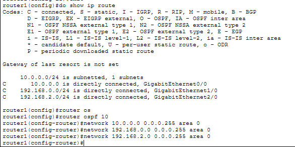

*router1 knows only its three connected networks: `10.0.0.0/24`, `192.168.0.0/24` and `192.168.2.0/24`. Each one then gets a `network` statement under `router ospf 10`.*

### Configure OSPF on every router

```cisco
! router1
router ospf 10
 network 10.0.0.0 0.0.0.255 area 0
 network 192.168.0.0 0.0.0.255 area 0
 network 192.168.2.0 0.0.0.255 area 0

! router2
router ospf 10
 network 10.10.0.0 0.0.0.255 area 0
 network 192.168.0.0 0.0.0.255 area 0
 network 192.168.1.0 0.0.0.255 area 0

! router3
router ospf 10
 network 10.20.0.0 0.0.0.255 area 0
 network 192.168.1.0 0.0.0.255 area 0
 network 192.168.2.0 0.0.0.255 area 0
```

| Command | What it does |
|---|---|
| `router ospf 10` | Starts OSPF **process 10**. The process ID is **locally significant**: it doesn't have to match on neighboring routers. I used 10 everywhere for consistency. |
| `network <address> <wildcard> area <id>` | Enables OSPF on every interface whose IP falls inside the range, and advertises that interface's subnet |
| `0.0.0.255` (wildcard mask) | The inverse of a subnet mask. `0` bits must match, `255` bits can be anything, so this matches the whole /24. |
| `area 0` | The **backbone area**. In single-area OSPF every router is in area 0. |

> ⚠️ **Common misconception:** I originally thought the process ID had to match on every router. It doesn't. For two routers to become OSPF neighbors, these must match on the shared link: **area ID, subnet and mask, hello and dead timers, authentication (if used), and MTU**.

### Confirm the adjacency

When two routers have exchanged their link-state databases, OSPF logs that the neighbor has reached the **FULL** state:

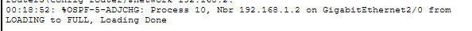

*`LOADING to FULL, Loading Done`: the routers on this link now have identical link-state databases, and each one runs SPF and installs the best routes. The neighbor is identified by its **router ID** (`192.168.1.2`), not by the address on the shared link. With no `router-id` configured, OSPF uses the router's highest interface IP address.*

---

## Step 5 – Testing and Verification

### Routing table

router3 now has OSPF routes (code `O`) to both remote LANs:

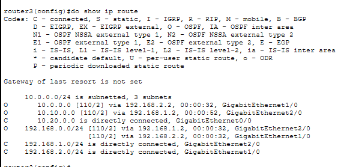

Reading `O 10.0.0.0 [110/2] via 192.168.2.2, GigabitEthernet1/0`:

| Field | Meaning |
|---|---|
| `O` | Learned through OSPF |
| `110` | Administrative distance (OSPF's default; lower is more trusted) |
| `2` | OSPF metric: the total cost of the path |
| `via 192.168.2.2` | Next hop (router1) |
| `GigabitEthernet1/0` | Exit interface |

*`192.168.0.0/24` has **two next hops with the same cost** (`[110/2]` via router1 and via router2). OSPF installs both and **load-balances across equal-cost paths** by default.*

### Ping and tracert between every LAN

**PC3 (10.20.0.10) → PC1 and PC2:**

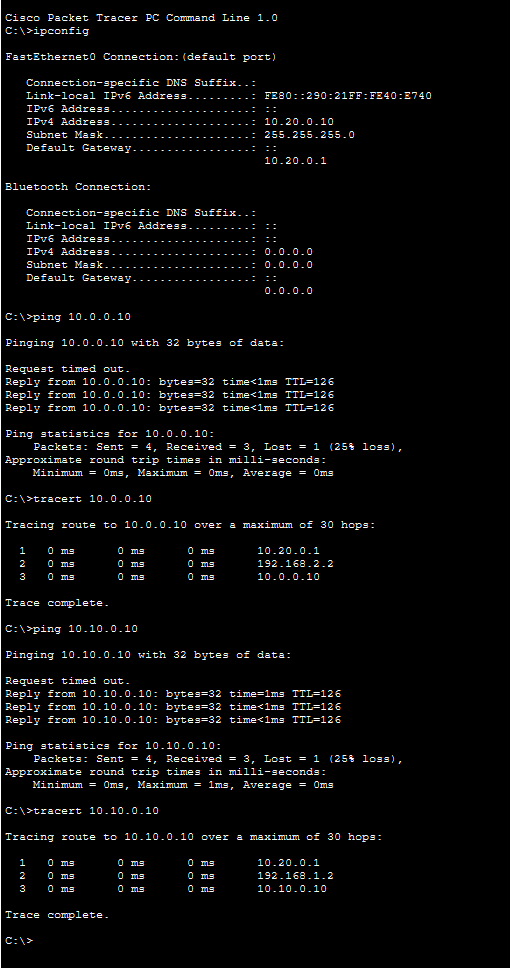

**PC2 (10.10.0.10) → PC3 and PC1:**

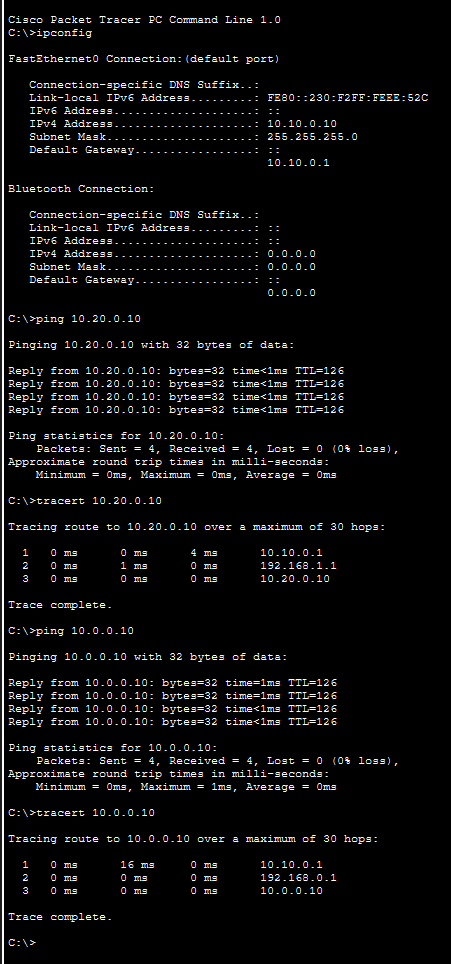

**PC1 (10.0.0.10) → PC2 and PC3:**

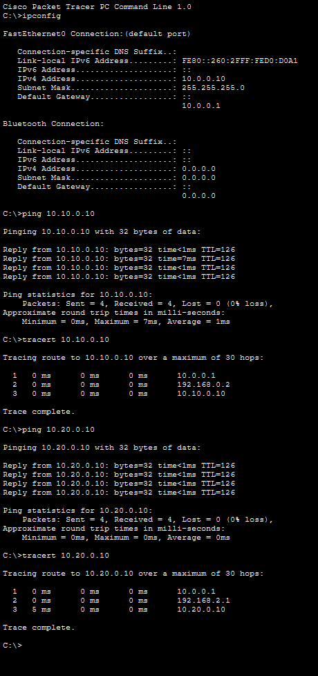

Details worth noticing:

- **Every LAN reaches every other LAN**, so OSPF is distributing all the routes.
- **TTL=126.** The PC starts at 128 and each router subtracts 1, so the traffic crossed **2 routers**.
- **The first ping timed out.** That's normal on a first attempt. The PCs and routers have to resolve MAC addresses with ARP before the first packet can be forwarded.
- **`tracert` takes the direct link** between the two routers each time, which is the lowest-cost path.

### Verification commands

```cisco
show ip route
show ip route ospf
show ip ospf neighbor
show ip protocols
show ip interface brief
```

```
C:\> ipconfig
C:\> ping <destination>
C:\> tracert <destination>
```

### ✅ Result

All three LANs can reach each other, and every route in the network was learned dynamically. No static routes were needed.

---

## Step 6 – Changing the Path with OSPF Cost

This step shows how an administrator can **influence** which path OSPF picks. The new path is deliberately *less* efficient.

### Before: the direct path

PC3 (10.20.0.10) reaches PC1 (10.0.0.10) over the direct router3 → router1 link:

```
10.20.0.1 (router3) → 192.168.2.2 (router1) → 10.0.0.10
```

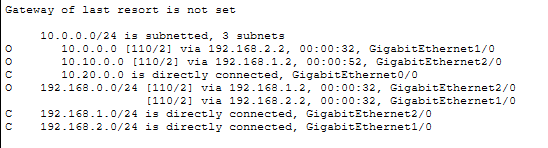

*router3 reaches `10.0.0.0/24` with a cost of **2** via 192.168.2.2.*

### How OSPF calculates cost

```
Cost = Reference bandwidth ÷ Interface bandwidth   (default reference bandwidth = 100 Mbps)
```

A route's metric is the **sum of the outgoing interface costs** along the path. With the default reference bandwidth, both FastEthernet and GigabitEthernet have a cost of **1**:

| Path from router3 to 10.0.0.0/24 | Cost before the change |
|---|---|
| router3 G1/0 → router1 G0/0 (direct) | 1 + 1 = **2** ✅ chosen |
| router3 G2/0 → router2 G1/0 → router1 G0/0 | 1 + 1 + 1 = **3** |

### Raise the cost of the direct link

I lowered the configured bandwidth on router3's G1/0 (the link to router1), which raises that link's OSPF cost above the path through router2:

```cisco
! router3
interface GigabitEthernet1/0
 bandwidth 100
```

`bandwidth` is in **kbps**, so `100` = 0.1 Mbps, and OSPF calculates a cost of 100,000 kbps ÷ 100 kbps = **1000**. The direct path now costs 1001, and the path through router2 (3) wins.

| Path from router3 to 10.0.0.0/24 | Cost after the change |
|---|---|
| router3 G1/0 → router1 G0/0 (direct) | 1000 + 1 = **1001** |
| router3 G2/0 → router2 G1/0 → router1 G0/0 | 1 + 1 + 1 = **3** ✅ chosen |

> 💡 The `bandwidth` command **does not change the real speed of the link**. It only changes the value routing protocols use in their calculations. `ip ospf cost <value>` sets the cost directly and doesn't affect anything else that reads the bandwidth value (QoS, for example).

### After: the new path

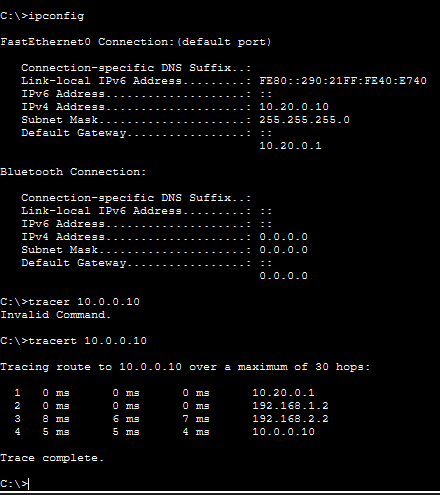

```
1  10.20.0.1     (router3)
2  192.168.1.2   (router2)
3  192.168.2.2   (router1)
4  10.0.0.10     (PC1)
```

Traffic now goes through router2, and the trace shows **4 hops instead of 3**.

> **Why does hop 3 show 192.168.2.2 instead of 192.168.0.1?** A router answers `tracert` from the interface it uses to send the reply **back** to the source. I changed the cost only on router3. router1's best path back to 10.20.0.0/24 is still its direct link (G2/0, 192.168.2.2), so its reply comes from that address. This is **asymmetric routing**: OSPF cost only affects traffic **leaving** the interface it's set on, so each direction of a conversation can take a different path.

```cisco
show ip ospf interface GigabitEthernet1/0
show ip route 10.0.0.0
```

---

## Command Summary

| Step | Commands |
|---|---|
| 2 – Base configuration | `hostname`, `enable secret`, `username … secret`, `ip domain-name`, `crypto key generate rsa general-keys modulus 1024`, `ip ssh version 2`, `line con 0` / `line aux 0` / `line vty 0 4`, `login local`, `logging synchronous`, `transport input ssh` |
| 3 – Interfaces | `interface`, `ip address`, `no shutdown` |
| 4 – OSPF | `show ip route`, `router ospf 10`, `network <net> <wildcard> area 0` |
| 5 – Verification | `show ip route`, `show ip route ospf`, `show ip ospf neighbor`, `show ip protocols`, `show ip interface brief`, `ipconfig`, `ping`, `tracert` |
| 6 – Changing the path | `interface`, `bandwidth`, `ip ospf cost` (alternative), `show ip ospf interface`, `tracert` |

---

## Key Takeaways

- **The OSPF process ID is locally significant.** The **area ID** must match between neighbors.
- **The `network` command matches interfaces:** it enables OSPF on them and advertises their subnets.
- **OSPF picks paths by cost**, which is based on bandwidth. `bandwidth` and `ip ospf cost` change the path without touching the physical link.
- **OSPF load-balances across equal-cost paths** automatically.
- **Cost is applied outbound**, so changing it on one router can create **asymmetric routing**.
- **With the default reference bandwidth, FastEthernet and GigabitEthernet both cost 1**, so OSPF can't tell them apart.

## Next Steps

- **Make the LAN interfaces passive** (`passive-interface GigabitEthernet0/0`). There are no OSPF routers on the PC LANs, so hellos there waste resources and let anyone plugged into the LAN try to form an adjacency. The LAN subnets are still advertised.
- **Set router IDs manually** (`router-id 1.1.1.1`, etc.) so each router's identity is predictable.
- **Raise the reference bandwidth** (`auto-cost reference-bandwidth 10000`) on every router so OSPF can tell 100 Mbps, 1 Gbps and 10 Gbps links apart.
- **Add OSPF authentication** so a rogue router can't inject routes.
- **Combine OSPF with VLANs across multiple sites**, using router-on-a-stick at each site. This builds on my [Inter-VLAN Routing lab](https://github.com/Mark-Hamlin/intervlan-routing-lab) and [Router-on-a-Stick lab](https://github.com/Mark-Hamlin/router-on-a-stick-lab).

---

## Final Configurations

- [router1.txt](configs/router1.txt)
- [router2.txt](configs/router2.txt)
- [router3.txt](configs/router3.txt): includes the Step 6 bandwidth change

The switches use the default configuration, so no switch configs are included.

> Password hashes are removed from the published configs.
